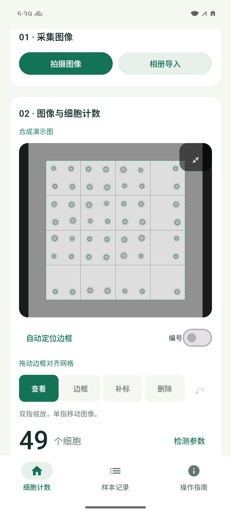
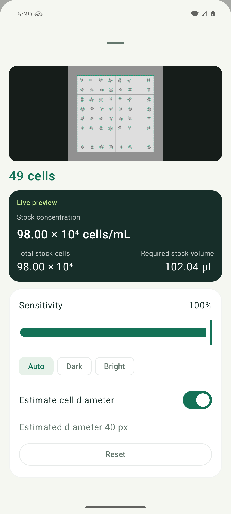
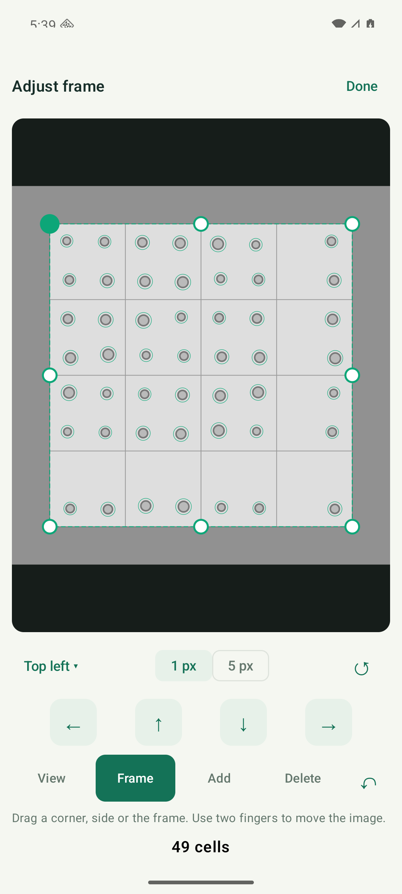

# Android

## English

cellscope for Android uses Kotlin and Jetpack Compose. Image analysis, records and calculations run on the device. The application supports Android 8.0 (API 26) and later; version 0.7.0 targets Android 16 (API 36).

### Install

Download `cellscope-0.7.0-android.apk` from [the Android release](https://github.com/caelricluo/cellscope/releases/tag/v0.7.0), open it on the phone and allow installation for the browser or file manager used to open the file. This APK is signed with an Android development certificate and uses a non-debuggable build configuration. The separate `-unsigned.apk` artifact is for subsequent signing.

### Workflow

1. Choose full-grid 4×, four-corner 10×, RBC or custom-area counting.
2. Capture through the microscope with the system camera, import with Android Photo Picker, or load a demo.
3. Automatic grid detection positions the frame. Open Frame to adjust corners, sides or the whole frame with a loupe and 1/5 px nudges. Pinch to zoom; use two fingers to pan while editing.
4. Open detection settings to view the image, markers, count, concentration, total cells and required volume together. Sensitivity, target appearance and diameter controls update the result after a 180 ms debounce.
5. In four-corner mode, import A1, A3, C1 and C3 separately. Concentration uses the counted squares and preserves the fractional mean. RBC mode starts with the four corners plus the center of the 5×5 central grid.
6. Enter chamber depth, dilution, stock volume and target cells. Results update directly. Reset controls restore chamber, detector or frame settings.
7. Save the sample to local records or share the CSV report and annotated PNG images through Android's share sheet.

A detected central grid offers an RBC shortcut while preserving other counting modes. Blank target or stock-volume fields affect only calculations that use those fields. Each connected cluster counts once; objects touching top/left boundaries are included and those touching bottom/right boundaries are excluded.

### Screenshots

Synthetic demo captures from Android 16:

| Counting · 中文 | Live parameters · English | Frame editor · English |
| --- | --- | --- |
|  |  |  |

### Build and verify

Use JDK 17 or 21, Android SDK platform 36 and build-tools 35.0.0. Open `android/` in Android Studio, or configure `ANDROID_HOME` and run:

```sh
cd android
./gradlew :core:test :app:lintPreview :app:assemblePreview :app:assembleRelease
# With an Android emulator or a connected test device:
./gradlew :app:connectedDebugAndroidTest
```

Build outputs:

| Variant | Path within `android/` | Signing |
| --- | --- | --- |
| preview | `app/build/outputs/apk/preview/app-preview.apk` | Development certificate; non-debuggable |
| release | `app/build/outputs/apk/release/app-release-unsigned.apk` | Unsigned |
| debug | `app/build/outputs/apk/debug/app-debug.apk` | Development certificate; debuggable |

From the repository root, `scripts/build_android.sh` runs the core tests, lint, builds and packaging. `python3 scripts/check_android_localizations.py` validates the English/Chinese keys, format arguments and UI copy. The packager verifies package ID, version, minimum/target SDK, signature, debuggable flag and ZIP integrity, then writes APKs, a JSON manifest and SHA-256 checksums into `dist/`.

For a deployment certificate, use Android's signing tools on the unsigned artifact:

```sh
zipalign -p -f 4 app-release-unsigned.apk cellscope-aligned.apk
apksigner sign --ks /path/to/signing-key.jks --out cellscope-signed.apk cellscope-aligned.apk
apksigner verify --verbose cellscope-signed.apk
```

### Source structure

```text
android/core/       Pure Kotlin detector, grid geometry, counting and numerical tests
android/app/        Compose UI, camera/picker integration, PNG records and exports
android/app/src/androidTest/  Emulator workflow tests
```

The core follows the Swift detector's local-noise thresholds, directional-median ruling suppression, connected-component grouping and perspective boundary rules. Gray images use byte storage; local-noise values are interpolated on demand. Grid and cell jobs support cancellation, and image/revision checks prevent an earlier task from replacing a newer result. Persistence commits each record as one directory containing metadata and lossless PNG images. Android and iOS keep separate local record stores.

For an 8-bit binary PGM diagnostic:

```sh
cd android
./gradlew :core:diagnose -Pimage=/absolute/path/image.pgm -Pmode=CORNERS -Psensitivity=1
```

Author: [@caelricluo](https://github.com/caelricluo) · Co-author: **Codex GPT-6.1 Sol**.

## 简体中文

cellscope Android 版使用 Kotlin 与 Jetpack Compose，在设备上完成图像分析、记录保存和计算。支持 Android 8.0（API 26）及以上；0.7.0 面向 Android 16（API 36）构建。

### 安装

从 [Android 发行页](https://github.com/caelricluo/cellscope/releases/tag/v0.7.0) 下载 `cellscope-0.7.0-android.apk`，在手机打开，并允许用于打开文件的浏览器或文件管理器安装应用。该 APK 使用 Android 开发证书签名，采用非调试构建配置。单独提供的 `-unsigned.apk` 用于后续签名。

### 使用

1. 选择 4× 完整九宫格、10× 四角分拍、红细胞或自定义面积模式。
2. 使用系统相机对准显微镜拍摄，或从 Android 照片选择器导入，也可载入演示样本。
3. 自动定位计数板网格。进入「框选」后，通过角点、边线或整体移动调整，配合局部放大镜和 1/5 像素微调。双指缩放，编辑时双指平移图像。
4. 打开识别参数，同屏查看图像、标记、计数、浓度、总细胞数和取液量。灵敏度、目标明暗和直径变化经 180 ms 合并后自动更新。
5. 四角模式分别导入 A1、A3、C1、C3，使用已计数格的面积计算浓度，平均数保留小数；红细胞模式默认计数中央 5×5 中格的四角加中心。
6. 输入腔室深度、稀释倍数、原液体积和目标细胞数，结果实时计算。提供计数板参数、识别参数和边框重置入口。
7. 保存到本机样本记录，或通过系统分享面板导出 CSV 与 PNG 标记图。

识别到中央网格时提供红细胞快捷入口，其他模式仍可使用。目标细胞数或原液体积留空时，仅对应的计算项留空。团块记为一个对象；按对象边缘执行记上不记下、记左不记右。

### 开发与打包

使用 JDK 17 或 21、Android SDK 36 与 build-tools 35.0.0，通过 Android Studio 打开 `android/`，或配置 `ANDROID_HOME` 后运行上文的 Gradle 命令。`preview` 生成开发证书签名的非调试 APK，`release` 生成未签名 APK，`debug` 用于调试和自动化测试。

在仓库根目录执行 `scripts/build_android.sh` 完成核心测试、Lint、编译和打包。`python3 scripts/check_android_localizations.py` 检查中英文键、占位符和界面文案。打包脚本检查包名、版本、系统版本、签名、调试标志和 ZIP 完整性，在 `dist/` 中生成 APK、JSON 清单和 SHA-256 校验文件。自有证书签名命令见上文。

`android/core/` 为纯 Kotlin 检测与计算核心，`android/app/` 为原生界面、采集、记录与导出，`android/app/src/androidTest/` 包含模拟器流程测试。算法保留 Swift 版本的局部噪声阈值、方向中位数刻线抑制、连通对象分组和透视压线规则；后台任务可取消，并校验图像与请求版本。每份样本以单独目录提交元数据与无损 PNG；Android 与 iOS 各自保存本地记录。

作者：[@caelricluo](https://github.com/caelricluo) · 共同作者：**Codex GPT-6.1 Sol**。
